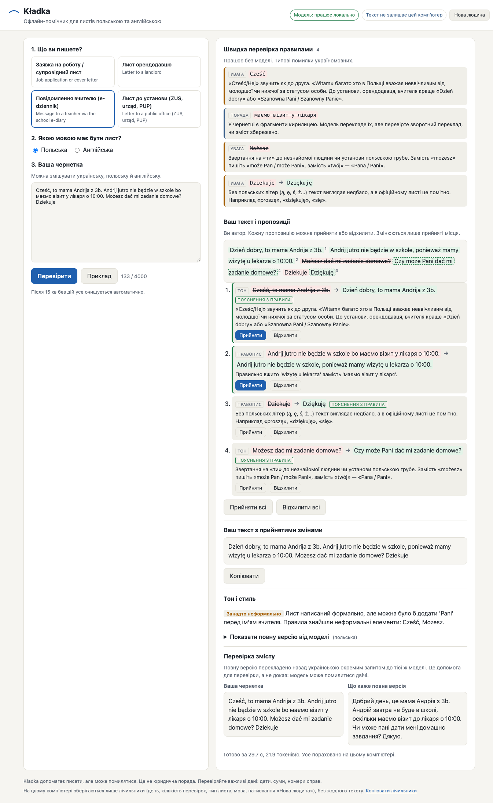

# Kładka

Kładka is an offline writing coach for Ukrainian speakers in Poland who need to write important texts in Polish or English: a job application, a letter to a landlord, a message to a teacher, or a letter to an office such as ZUS, a urząd or a PUP.

It runs on one laptop. After setup it needs no network, and no text leaves the machine.

The name comes from the Polish "kładka" and the Ukrainian "кладка": a small footbridge. (The repository and code use the ASCII spelling "kladka". The working name "Plainword" was dropped because plainword.com is already a grammar checker for macOS.)

## What it does

You pick a task, pick the target language (Polish or English), and write or paste a draft. The draft can mix Ukrainian, Polish and English.

Kładka is a coach, not a rewriter. You stay the author:

1. **Your own text with suggestions inline.** Each suggested change is highlighted in your draft, with a short reason **in Ukrainian**. You accept or reject each one. Only accepted changes are applied, and you copy the result.
2. **Reasons that know Ukrainian speakers' typical mistakes:** Polish case endings and prepositions (szukam pracy, czekam na odpowiedź), missing English articles, false friends (квартира is "mieszkanie", not "kwatera"; заява is "wniosek", not "zjawa"), and formal address (Szanowny Panie, Szanowna Pani, Dear Ms ...).
3. **A register check.** Is the draft too informal for an office or a teacher?
4. **A meaning check.** The model's full version is translated back into Ukrainian in a separate call that sees only that version. You compare it with what you meant. The back-translation comes from the same model, so it is an aid for checking, not proof that the meaning is right.
5. **The full rewritten version** is available behind "show full version" as a hint, not as the default.

Before the model runs, a rule engine (47 rules, each with a Ukrainian explanation) checks the draft for known Ukrainian-speaker errors. Its results appear at once and work even when no model is loaded.

Kładka also warns when the model's full version contains numbers that were not in your draft, or placeholders like `[Your Name]`.

It is not a chatbot. There is no open conversation, only the four task presets below and a fixed output.



More screenshots: [a landlord letter](docs/screenshot-landlord.png) (it also shows a bad model suggestion, "kwatera" to "w mieszkaniu", which produces "w w mieszkaniu" when accepted, as in the screenshot) and [an English job application](docs/screenshot-job-en.png).

## Task presets

Each preset changes the prompt: who the reader is, the expected register and the genre conventions.

| Preset | Reader and conventions |
|---|---|
| Job application or cover letter | Employer in Poland. Polish "list motywacyjny" format (Szanowni Państwo, position, experience with exact dates, availability, Z poważaniem). Reminds about the RODO consent clause when a Polish CV is mentioned. |
| Letter to a landlord | Private landlord or manager. Problem, facts, one concrete request, formal address. |
| Message to a teacher via the school e-diary | Teacher reading in e-dziennik (Librus, Vulcan). Short, Pani/Pan, child and class named, clear request. |
| Letter to a public office | ZUS, urząd wojewódzki, urząd miasta or gminy, PUP. Names the matter first (for example PESEL UKR status, a residence card including the CUKR card, 800 plus), keeps every number and case reference, Szanowni Państwo / Z poważaniem. |

All four work with Polish or English as the target.

## Who it is for

People who fled the war in Ukraine and now live in Poland, and who must write texts where mistakes have a cost: a missed repair, a misunderstood school absence, a rejected application. Also for the volunteers, teachers and caseworkers who help them, often at a shared laptop.

## Why local

These texts contain PESEL numbers, case numbers, addresses, health details and family situations. Sending them to a cloud service is a real risk for people who already depend on others for a lot. Kładka keeps everything on the laptop, uses an open model with an open license, and does not depend on any company API.

## Shared laptops

- A **"New person"** button (Нова людина) clears the draft, all results and the browser's localStorage and sessionStorage.
- After **15 minutes** without any input the page clears itself. Change it with `KLADKA_IDLE_MINUTES=10 npm start`.

## Local counts

To learn whether the tool is used, without collecting any text, the server keeps one small file, `data/counts.json`:

```json
{ "2026-11-01": { "checks": 3, "tasks": { "landlord": 2, "job": 1 }, "targets": { "pl": 3 }, "new_person": 1 } }
```

That is all it stores: the day, the number of checks, the task type, the target language and the number of "New person" clicks. No draft text, no results, no names, no time of day. It is never sent anywhere. The "Copy counts" link at the bottom of the page copies it so a partner can paste it into a report by hand. Turn it off with `KLADKA_COUNTS=0`, or move it with `KLADKA_COUNTS_FILE=/path/counts.json`.

## Hardware

Measured on one machine only: **Apple M3 Pro, 36 GB RAM, macOS 26**. See "Measured results" for the memory the model process used.

- The target is a laptop with 16 GB of RAM. **16 GB machines are untested.**
- About 6 GB of free disk for the model.
- llama.cpp also runs on Linux and Windows, on CPU or GPU. **Windows and Linux are untested.** On a laptop without a GPU or Apple Silicon, expect it to be several times slower.

## Setup

You need [llama.cpp](https://github.com/ggml-org/llama.cpp) (`llama-server`) and Node.js 22 or newer. Kładka has no npm dependencies.

```sh
brew install llama.cpp          # or build llama.cpp for your system
./scripts/get-model.sh          # one time: downloads 5.6 GB and checks sha256
./scripts/start-model.sh        # starts the model on 127.0.0.1:8080
npm start                       # then open http://127.0.0.1:8787
```

After `get-model.sh` you can switch off the network.

```sh
npm test                        # rule engine, JSON validator and counts tests
npm run eval                    # runs the synthetic eval set (needs the model running)
```

`start-model.sh` uses `--no-jinja`: with llama.cpp 0.8.0 (build 11960) the Jinja chat path broke grammar-constrained JSON for this model ("Failed to initialize samplers"). The built-in ChatML template matches the model's own template.

## The model

- **EuroLLM-9B-Instruct-2512** ([utter-project/EuroLLM-9B-Instruct-2512](https://huggingface.co/utter-project/EuroLLM-9B-Instruct-2512)), an open multilingual model from the European EuroLLM / UTTER research project. Its model card lists Polish and Ukrainian among its languages. It uses a Llama-style architecture but is trained by the EuroLLM team; it is not a Meta Llama model.
- License: **Apache 2.0**.
- File: `EuroLLM-9B-Instruct-2512.Q4_K_M.gguf` from [mradermacher/EuroLLM-9B-Instruct-2512-GGUF](https://huggingface.co/mradermacher/EuroLLM-9B-Instruct-2512-GGUF), 5,582,838,912 bytes, sha256 `fe9b50d4ba67eb0131f1ceeaab2e56ea8fb6b2bbc37391d3219c791c3b140a28`.
- Output is constrained by llama.cpp to a fixed JSON schema (`src/schema.mjs`). The Ukrainian explanation fields are constrained to start with a Cyrillic letter and to exclude letters that exist only in Russian (ы, э, ъ, ё); without that the model sometimes explained in Russian or English. Every answer is validated again in Kładka. If it fails, Kładka retries (another seed, then without the grammar) and otherwise shows the rule results only.

## How it works

```
draft ─► rule engine (instant, no model) ─► hits shown in Ukrainian
      └► llama-server on 127.0.0.1 ─► JSON: full version, register, changes ─► validate ─► inline suggestions
                                     └► second call: back-translate the full version to Ukrainian ─► validate
```

- `server.mjs`: a small Node server with no dependencies. It listens on 127.0.0.1 only, rejects other Host headers, and sets a strict Content Security Policy.
- `src/rules.mjs`: the rule engine and the UA to PL and UA to EN rules. Its structure is adapted from the MIT-licensed [bln-mcp-grammar-server](https://github.com/theluckystrike/bln-mcp-grammar-server); the rules are new.
- `src/pipeline.mjs`: prompts, model calls, validation and retries. It refuses a model URL that is not on this machine.
- `src/tasks.mjs`: the four task presets.
- `src/counts.mjs`: the local counts file.
- `public/`: the interface, in Ukrainian. Plain HTML, CSS and JavaScript, no external fonts or scripts.

## Measured results

From [eval/results.json](eval/results.json): 20 synthetic drafts (4 presets, both target languages), one run on an Apple M3 Pro with 36 GB RAM, llama.cpp 0.8.0 with Metal, `-c 8192`.

| Metric | Value |
|---|---|
| Seconds per draft (two model calls), median / p90 | 39.5 / 128.1 s |
| Generation speed, mean | 21.4 tokens/s |
| llama-server memory (RSS), peak at `-c 8192` | 7,222 MB |
| llama-server memory (RSS), peak at `-c 4096` (5 drafts) | 6,745 MB |
| Model JSON usable on first attempt / after retries | 17/20 / 20/20 |
| Explanations in Ukrainian and corrected text without Cyrillic | 20/20 |
| Facts (names, numbers, dates) kept in the full version | 72/78 (all 6 misses are dropped signatures) |
| Full versions with a number not in the draft | 1/20 |
| Model suggestions shown inline in the writer's text | 77/83 |
| Expected rule hits found (rules written by the same author) | 62/62 |
| Register: model alone caught clearly informal drafts | 0/4 |
| Register: model plus register rules agree with author labels | 12/12 |

RSS includes the memory-mapped 5.2 GB model file. The memory need on a 16 GB laptop is therefore about 7 GB for the model process, but this has not been tested on a 16 GB machine.

See [eval/README.md](eval/README.md) for what each number means and what the eval does not show.

## Privacy

- Kładka makes no network requests except to `127.0.0.1`.
- No analytics, no telemetry, no external fonts or scripts.
- Drafts are not saved to disk or logged. They live in memory for one request. The only file written is the counts file described above.
- The model runs in a separate local process (`llama-server`) that listens on 127.0.0.1 only.

## Limits

- Kładka is a writing aid. It is not legal advice and not an official translation.
- The model can be wrong. In testing it sometimes made a phrase worse, kept an error the rules had flagged, gave a weak or wrong reason, or added details that were not in the draft (an invented address, a recipient name, `[Your Name]`). The back-translation once invented a signature name. That is why suggestions are opt-in, why the meaning check exists, and why you must check every date, amount, name and case number yourself.
- Some suggestions cannot be shown inline because the model's "from" fragment is not word for word in the draft. Those are listed for manual editing.
- The rule set is small (47 rules) and was written by one person. It finds known patterns only.
- The eval set is synthetic and small (20 drafts), written by the author, so the rule hit rate on it is optimistic.
- One check takes most of a minute on the test machine. On a slower laptop it will take longer.
- It has not yet been used by the people it is meant for.

## Governance

A proposed governance model with a refugee-majority advisory group is in [docs/GOVERNANCE.md](docs/GOVERNANCE.md). It is proposed and not yet constituted.

## Roadmap

1. Test with Ukrainian speakers and the volunteers who help them in Poland, and change the tool based on what they say.
2. Grow the rule set with real (consented, anonymized) error patterns, reviewed by Polish and English teachers.
3. A larger eval set with human ratings of correctness and meaning preservation.
4. More task presets (doctor, bank, court letters) and Russian-speaker support.
5. A one-click installer for Windows and Linux laptops, measured on 16 GB and 8 GB machines.

## License

Code: Apache License 2.0 (see `LICENSE` and `NOTICE`). The model has its own license (Apache 2.0) and is not included in this repository.
